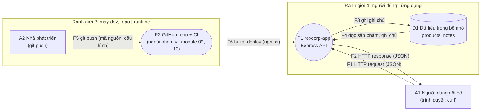
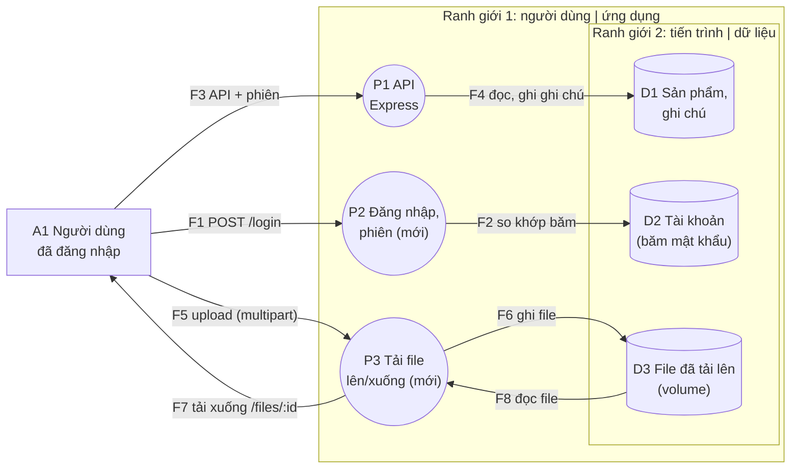

# Threat model của `rexcorp-app`

Tài liệu đọc được trên GitHub của threat model. Bản gốc, mở được bằng OWASP Threat Dragon 2.6.2, là [`rexcorp-app.json`](rexcorp-app.json). Hai nơi phải khớp nhau: sửa một nơi thì sửa nơi kia trong cùng pull request.

- Phạm vi: `rexcorp-app` v0.1.0 (DFD-1) và thiết kế đề xuất thêm đăng nhập, tải file (DFD-2).
- Người phụ trách: kỹ sư DevOps phụ trách bảo mật. Người review: CTO.
- Cập nhật lần cuối: 2026-10-06 (Lab 03).
- Phương pháp: bốn câu hỏi của Threat Modeling Manifesto; sáu loại threat STRIDE; xếp hạng L×I thang 1 đến 3 (điểm 6 trở lên là High, 3 đến 5 là Medium, 1 đến 2 là Low).
- Requirement tương ứng: [`SECURITY-REQUIREMENTS.md`](../../SECURITY-REQUIREMENTS.md). Ma trận truy vết: [`docs/security-traceability.md`](../security-traceability.md).

## 1. Chúng ta đang làm gì (DFD)

### DFD-1: `rexcorp-app` hiện tại

Rút ra từ mã nguồn: năm route trong `src/app.js`, dữ liệu trong bộ nhớ ở `src/store.js`, image dựng bằng `Dockerfile`, chạy bằng `compose.yaml`.

### DFD-2: thiết kế đề xuất, thêm đăng nhập và tải file

## 2. Tài sản cần bảo vệ

| Tài sản | Ở đâu | Vì sao quan trọng |
|---|---|---|
| Ghi chú nội bộ về sản phẩm | D1 | Thông tin kinh doanh nội bộ; chỉ nhân viên được xem |
| Tính xác thực của tác giả ghi chú | F1, P1 | Quyết định nghiệp vụ dựa vào "ai viết" |
| Thông tin đăng nhập và băm mật khẩu (thiết kế mới) | D2, F1 | Lộ là mất tài khoản |
| File người dùng tải lên (thiết kế mới) | D3 | Dữ liệu của khách hàng; có thể bị lạm dụng để chạy mã |
| Tính sẵn sàng của dịch vụ | P1, D1, D3 | Đội dùng hằng ngày |
| Mã nguồn và secret | F5 | Lộ secret là có quyền mà secret mở ra (SEC-001) |
| Tính toàn vẹn của image và dependency | F6 | Mã độc trong dependency chạy với quyền của ứng dụng |

## 3. Bảng threat theo STRIDE

Điểm L×I và mức do nhóm đánh giá (nhận định của khóa học). Mô tả, bằng chứng và lý do nằm ở phần 4.

| ID | DFD, phần tử | STRIDE | Threat | L×I | Mức | Phản hồi | Trạng thái | Requirement |
|---|---|---|---|---|---|---|---|---|
| T-01 | DFD-1: A1 Người dùng nội bộ | Spoofing | Mạo danh tác giả ghi chú | 3×2=6 | High | Mitigate | Open | REQ-01 |
| T-02 | DFD-1: F2 response | Information disclosure | Ghi chú nội bộ đọc được không cần xác thực | 3×2=6 | High | Mitigate | Open | REQ-01 |
| T-03 | DFD-1: F1 request | Tampering | Đầu vào sai kiểu, sai định dạng, quá lớn | 2×2=4 | Medium | Mitigate | Mitigated | REQ-04 |
| T-04 | DFD-1: D1 Dữ liệu trong bộ nhớ | Tampering | Ghi chú chứa HTML hoặc script được lưu và phát lại nguyên văn | 2×2=4 | Medium | Mitigate | Open | REQ-10 |
| T-05 | DFD-1: P1 rexcorp-app | Repudiation | Không có nhật ký về ai ghi gì, lúc nào | 2×2=4 | Medium | Accept | Accepted | không có (xem ADR) |
| T-06 | DFD-1: D1 Dữ liệu trong bộ nhớ | Denial of service | Số ghi chú không giới hạn làm đầy bộ nhớ | 2×2=4 | Medium | Mitigate | Open | REQ-10 |
| T-07 | DFD-1: P1 rexcorp-app | Information disclosure | Siêu dữ liệu nguồn (.git, .env) lọt vào image hoặc được phục vụ | 1×3=3 | Medium | Mitigate | Mitigated | REQ-08 |
| T-08 | DFD-1: F1 request | Information disclosure | Lưu lượng HTTP không mã hóa nếu triển khai ra ngoài máy dev | 1×3=3 | Medium | Accept | Accepted | không có (xem ADR) |
| T-09 | DFD-1: F5 git push | Information disclosure | Secret nằm trong mã nguồn hoặc lịch sử git | 2×3=6 | High | Mitigate | Mitigated | REQ-09 |
| T-10 | DFD-1: F6 build, deploy | Tampering | Thư viện bên thứ ba có lỗ hổng hoặc mã độc đi vào image | 2×3=6 | High | Mitigate | Open | REQ-07 |
| T-11 | DFD-2: P2 Đăng nhập, phiên | Spoofing | Nhồi thông tin đăng nhập hoặc dò mật khẩu | 3×3=9 | High | Mitigate | Open | REQ-03 |
| T-12 | DFD-2: P3 Tải file | Information disclosure | Người dùng B truy cập file của người dùng A bằng cách đổi mã file | 2×3=6 | High | Mitigate | Open | REQ-02 |
| T-13 | DFD-2: P3 Tải file | Tampering | Tên file do người dùng gửi dẫn tới ghi ra ngoài thư mục lưu trữ | 2×3=6 | High | Mitigate | Open | REQ-06 |
| T-14 | DFD-2: P3 Tải file | Denial of service | Tải lên file rất lớn làm cạn đĩa hoặc bộ nhớ | 2×2=4 | Medium | Mitigate | Open | REQ-05 |
| T-15 | DFD-2: D3 File đã tải lên | Tampering | File độc hại được lưu rồi phục vụ lại như nội dung tin cậy | 2×3=6 | High | Mitigate | Open | REQ-10 |
| T-16 | DFD-2: D2 Tài khoản | Information disclosure | Lộ cơ sở dữ liệu tài khoản, mật khẩu băm yếu bị dò ngược | 2×3=6 | High | Mitigate | Open | REQ-10 |
| T-17 | DFD-1: A2 Nhà phát triển | Spoofing | Dùng thông tin đăng nhập GitHub bị lộ của nhà phát triển để đẩy mã độc | 2×3=6 | High | Mitigate | Open | REQ-10 |

Chú giải trạng thái (theo Threat Dragon): **Open** chưa xử lý xong; **Mitigated** đã có control và kiểm chứng; **Accepted** chấp nhận có lý do.

## 4. Chi tiết từng threat

### T-01: Mạo danh tác giả ghi chú

- **Loại và vị trí:** Spoofing, DFD-1 phần tử A1
- **Mô tả:** Bất kỳ ai gọi được API (không cần tài khoản) gửi POST /api/products/:id/notes với author tùy ý, ví dụ an.nguyen, và ghi chú hiện ra như do người đó viết.
- **L×I:** 3×2 = 6 (High)
- **Phản hồi:** Mitigate. Thêm đăng nhập; lấy author từ danh tính đã xác thực, không nhận từ body (REQ-01).
- **Requirement:** REQ-01
- **Bằng chứng:** curl POST không thông tin xác thực trả 201 (Bước 3)
- **Trạng thái:** Open

### T-02: Ghi chú nội bộ đọc được không cần xác thực

- **Loại và vị trí:** Information disclosure, DFD-1 phần tử F2
- **Mô tả:** Ai tới được cổng của ứng dụng cũng đọc được ghi chú nội bộ của mọi sản phẩm qua GET /api/products/:id/notes.
- **L×I:** 3×2 = 6 (High)
- **Phản hồi:** Mitigate. Yêu cầu quyền truy cập theo chức năng cho mọi route trừ /healthz (REQ-01).
- **Requirement:** REQ-01
- **Bằng chứng:** curl GET notes trả 200 không cần xác thực (Bước 3)
- **Trạng thái:** Open

### T-03: Đầu vào sai kiểu, sai định dạng, quá lớn

- **Loại và vị trí:** Tampering, DFD-1 phần tử F1
- **Mô tả:** Kẻ tấn công gửi category lạ hoặc mảng, author chứa ký tự đặc biệt, body JSON hỏng hoặc quá 10 KB để làm sai lệch dữ liệu hoặc làm ứng dụng lỗi.
- **L×I:** 2×2 = 4 (Medium)
- **Phản hồi:** Mitigate. Đã làm: kiểm tra theo allowlist trong validateNote và CATEGORIES; giới hạn body 10 KB (REQ-04).
- **Requirement:** REQ-04
- **Bằng chứng:** 400 và 413 thật ở Bước 3; test có sẵn trong test/app.test.js
- **Trạng thái:** Mitigated

### T-04: Ghi chú chứa HTML hoặc script được lưu và phát lại nguyên văn

- **Loại và vị trí:** Tampering, DFD-1 phần tử D1
- **Mô tả:** Kẻ tấn công lưu ghi chú . API trả đúng chuỗi đó; nếu một giao diện sau này chèn vào trang mà không mã hóa đầu ra thì thành stored XSS.
- **L×I:** 2×2 = 4 (Medium)
- **Phản hồi:** Mitigate. Mã hóa đầu ra ở nơi hiển thị (ASVS 1.2.1). Chưa có giao diện nên requirement chưa chặn gì hôm nay; từ Lab 04, SAST là gate. Ghi backlog SEC-005.
- **Requirement:** REQ-10
- **Bằng chứng:** curl POST ghi chú có thẻ img trả 201, GET trả đúng chuỗi (Bước 3)
- **Trạng thái:** Open

### T-05: Không có nhật ký về ai ghi gì, lúc nào

- **Loại và vị trí:** Repudiation, DFD-1 phần tử P1
- **Mô tả:** Người ghi một ghi chú sai chối việc đó; ứng dụng chỉ in một dòng 'listening' khi khởi động nên không có bằng chứng.
- **L×I:** 2×2 = 4 (Medium)
- **Phản hồi:** Accept. Chấp nhận tạm thời: chưa có đăng nhập thì nhật ký cũng không gắn được danh tính. Làm cùng REQ-01; ASVS 16.3.1 là L2 nên chưa chọn (SEC-006).
- **Requirement:** không có (xem ADR-0003)
- **Bằng chứng:** docker logs chỉ có một dòng sau 500 request (Bước 3)
- **Trạng thái:** Accepted

### T-06: Số ghi chú không giới hạn làm đầy bộ nhớ

- **Loại và vị trí:** Denial of service, DFD-1 phần tử D1
- **Mô tả:** Kẻ tấn công gửi liên tục POST hợp lệ; mỗi ghi chú tới 500 ký tự, nhưng số lượng và tốc độ không bị giới hạn, compose.yaml không đặt giới hạn bộ nhớ, dữ liệu nằm trong RAM.
- **L×I:** 2×2 = 4 (Medium)
- **Phản hồi:** Mitigate. Giới hạn tốc độ ở cổng vào và giới hạn bộ nhớ container. ASVS 2.4.1 là L2 nên chưa chọn ở L1 (SEC-004).
- **Requirement:** không có (xem ADR-0003)
- **Bằng chứng:** 1.000 POST hợp lệ liên tiếp đều trả 201, không có 429 (Bước 3)
- **Trạng thái:** Open

### T-07: Siêu dữ liệu nguồn (.git, .env) lọt vào image hoặc được phục vụ

- **Loại và vị trí:** Information disclosure, DFD-1 phần tử P1
- **Mô tả:** Nếu image chứa thư mục .git hoặc file .env và ứng dụng phục vụ chúng, kẻ tấn công tải mã nguồn, lịch sử và secret.
- **L×I:** 1×3 = 3 (Medium)
- **Phản hồi:** Mitigate. Đã làm: .dockerignore loại .git, .env, test, docs; Express không phục vụ file tĩnh (REQ-08).
- **Requirement:** REQ-08
- **Bằng chứng:** 404 cho /.git/config; ls -A trong image không có .git (Bước 3)
- **Trạng thái:** Mitigated

### T-08: Lưu lượng HTTP không mã hóa nếu triển khai ra ngoài máy dev

- **Loại và vị trí:** Information disclosure, DFD-1 phần tử F1
- **Mô tả:** Ứng dụng chỉ nói HTTP. Nếu ai đó đưa ra mạng chung mà không đặt lớp TLS phía trước, kẻ nghe lén thấy toàn bộ dữ liệu.
- **L×I:** 1×3 = 3 (Medium)
- **Phản hồi:** Accept. Chấp nhận trong phạm vi khóa 1: compose chỉ publish 127.0.0.1 và SECURITY.md cấm deploy ra Internet. TLS thuộc hạ tầng (khóa 2). ASVS 12.2.1 ghi trong ADR là chưa chọn.
- **Requirement:** không có (xem ADR-0003)
- **Bằng chứng:** compose.yaml bind 127.0.0.1; README: không deploy ra Internet
- **Trạng thái:** Accepted

### T-09: Secret nằm trong mã nguồn hoặc lịch sử git

- **Loại và vị trí:** Information disclosure, DFD-1 phần tử F5
- **Mô tả:** Nhà phát triển commit một khóa API vào repo; ai đọc được repo (kể cả repo public) có quyền mà khóa đó mở ra. Đây là SEC-001 của module 02.
- **L×I:** 2×3 = 6 (High)
- **Phản hồi:** Mitigate. Đã làm ở module 02: pre-commit hook, job secret-scan, push protection, runbook. Chỉ phủ phần 'không có secret trong mã nguồn' của REQ-09 (REQ-09).
- **Requirement:** REQ-09
- **Bằng chứng:** Gate secret-scan chặn bản vá thanh toán (Lab 02)
- **Trạng thái:** Mitigated

### T-10: Thư viện bên thứ ba có lỗ hổng hoặc mã độc đi vào image

- **Loại và vị trí:** Tampering, DFD-1 phần tử F6
- **Mô tả:** npm ci kéo express và các phụ thuộc gián tiếp vào image. Nếu một phiên bản có lỗ hổng đã biết hoặc bị cài mã độc, mã đó chạy với quyền của ứng dụng.
- **L×I:** 2×3 = 6 (High)
- **Phản hồi:** Mitigate. Quét dependency và đặt thời hạn xử lý theo mức độ; ghi trong tài liệu (REQ-07). Triển khai ở module 05.
- **Requirement:** REQ-07
- **Bằng chứng:** package-lock.json ghim phiên bản; chưa có quét SCA (module 05)
- **Trạng thái:** Open

### T-11: Nhồi thông tin đăng nhập hoặc dò mật khẩu

- **Loại và vị trí:** Spoofing, DFD-2 phần tử P2
- **Mô tả:** Kẻ tấn công thử hàng loạt cặp tài khoản, mật khẩu bị lộ ở nơi khác (credential stuffing) hoặc dò mật khẩu của một tài khoản; thành công thì mạo danh người dùng thật.
- **L×I:** 3×3 = 9 (High)
- **Phản hồi:** Mitigate. Giới hạn số lần thử và làm chậm theo tài khoản và địa chỉ; ghi tài liệu cách cấu hình, tránh khóa tài khoản bị lợi dụng (REQ-03).
- **Requirement:** REQ-03
- **Bằng chứng:** Chưa có tính năng; yêu cầu viết trước khi làm
- **Trạng thái:** Open

### T-12: Người dùng B truy cập file của người dùng A bằng cách đổi mã file

- **Loại và vị trí:** Information disclosure, DFD-2 phần tử P3 (đọc dữ liệu của người khác; nếu IDOR cho phép ghi hoặc xóa thì thêm một threat Tampering)
- **Mô tả:** Đường dẫn /files/:id dự đoán được; người dùng đã đăng nhập đổi :id và đọc file không thuộc về mình (IDOR/BOLA): quyền truy cập dữ liệu không được kiểm tra theo từng đối tượng.
- **L×I:** 2×3 = 6 (High)
- **Phản hồi:** Mitigate. Kiểm tra quyền truy cập theo từng file ở tầng dịch vụ; mã file không đoán được chỉ là lớp phụ (REQ-02).
- **Requirement:** REQ-02
- **Bằng chứng:** Chưa có tính năng; test tích hợp viết trước
- **Trạng thái:** Open

### T-13: Tên file do người dùng gửi dẫn tới ghi ra ngoài thư mục lưu trữ

- **Loại và vị trí:** Tampering, DFD-2 phần tử P3
- **Mô tả:** Kẻ tấn công đặt tên file ../../app/src/app.js hoặc dùng đường dẫn tuyệt đối; nếu server ghép tên đó vào đường dẫn, file bị ghi đè hoặc ghi ra ngoài thư mục lưu trữ (path traversal).
- **L×I:** 2×3 = 6 (High)
- **Phản hồi:** Mitigate. Đặt tên file lưu trữ bằng giá trị server tự sinh, không dùng tên người dùng gửi (REQ-06).
- **Requirement:** REQ-06
- **Bằng chứng:** Chưa có tính năng; test tích hợp viết trước
- **Trạng thái:** Open

### T-14: Tải lên file rất lớn làm cạn đĩa hoặc bộ nhớ

- **Loại và vị trí:** Denial of service, DFD-2 phần tử P3
- **Mô tả:** Một người dùng (hoặc kẻ có tài khoản miễn phí) tải liên tục file lớn; không có giới hạn kích thước thì đĩa đầy, ứng dụng ngừng hoạt động.
- **L×I:** 2×2 = 4 (Medium)
- **Phản hồi:** Mitigate. Giới hạn kích thước mỗi file, kể cả khi giải nén, theo giá trị ghi trong tài liệu (REQ-05).
- **Requirement:** REQ-05
- **Bằng chứng:** Chưa có tính năng; test tích hợp viết trước
- **Trạng thái:** Open

### T-15: File độc hại được lưu rồi phục vụ lại như nội dung tin cậy

- **Loại và vị trí:** Tampering, DFD-2 phần tử D3
- **Mô tả:** Người dùng tải file HTML hoặc SVG chứa script; nếu ứng dụng phục vụ lại với Content-Type do người gửi khai báo thì trình duyệt của người khác chạy script đó.
- **L×I:** 2×3 = 6 (High)
- **Phản hồi:** Mitigate. Kiểm tra nội dung theo loại file đã ghi tài liệu và phục vụ kèm Content-Disposition: attachment (ASVS 5.2.2, 3.2.1). Chưa chọn vì thiết kế upload chưa có; ĐIỀU KIỆN TRƯỚC KHI MERGE tính năng tải file (SEC-007).
- **Requirement:** không có (xem ADR-0003)
- **Bằng chứng:** Chưa có tính năng; ghi backlog SEC-007
- **Trạng thái:** Open

### T-16: Lộ cơ sở dữ liệu tài khoản, mật khẩu băm yếu bị dò ngược

- **Loại và vị trí:** Information disclosure, DFD-2 phần tử D2
- **Mô tả:** Kẻ tấn công đọc được kho tài khoản (qua lỗ hổng khác hoặc bản sao lưu). Nếu mật khẩu được băm yếu, chúng bị dò ngược và dùng ở dịch vụ khác của người dùng.
- **L×I:** 2×3 = 6 (High)
- **Phản hồi:** Mitigate. Chọn thuật toán băm mật khẩu được phê duyệt và chốt trong thiết kế đăng nhập. Chưa chọn requirement ASVS nào ở bộ L1 này (ADR-0003; SEC-003).
- **Requirement:** không có (xem ADR-0003)
- **Bằng chứng:** Chưa có tính năng; ghi backlog SEC-003
- **Trạng thái:** Open

### T-17: Dùng thông tin đăng nhập GitHub bị lộ của nhà phát triển để đẩy mã độc

- **Loại và vị trí:** Spoofing, DFD-1 phần tử A2
- **Mô tả:** Kẻ tấn công có token hoặc mật khẩu GitHub của một nhà phát triển, push mã độc lên nhánh chính; CI build và triển khai nó.
- **L×I:** 2×3 = 6 (High)
- **Phản hồi:** Mitigate. Bảo vệ nhánh main, yêu cầu review, xác thực mạnh cho tài khoản nhà phát triển. Thuộc bảo vệ pipeline (module 09), không thuộc phạm vi ASVS.
- **Requirement:** không có (xem ADR-0003)
- **Bằng chứng:** Repo chưa bật branch protection (SEC-002, module 08, 09)
- **Trạng thái:** Open

## 5. Câu hỏi 4: đủ tốt chưa?

| Câu hỏi review | Trả lời ngày 2026-10-06 |
|---|---|
| DFD có phản ánh đúng thiết kế không? | DFD-1 rút từ mã nguồn và đã đối chiếu bằng `curl` (Lab 03, Bước 3). DFD-2 là thiết kế đề xuất, cần Product xác nhận. Ba phần tử của DFD-2 (A1, P1, D1) trùng với DFD-1 hoặc đã xét ở T-11, nên không có threat riêng |
| Mỗi threat có phản hồi chưa? | Có, 17 trên 17 |
| Mitigation đã giảm rủi ro về mức chấp nhận được chưa? | Chưa với các threat Open; kế hoạch trong `docs/security-backlog.md` (SEC-003 đến SEC-008) |
| Mitigation có test được không? | Mọi requirement có cách kiểm tra ghi trong ma trận truy vết; riêng REQ-09 máy chỉ kiểm được một nửa |
| Lưu ở nơi cả nhóm mở được cùng code chưa? | Có: `docs/threat-model/` trong repo |

## 6. Khi nào phải cập nhật

Cập nhật khi một pull request làm đổi DFD: thêm hoặc bớt tác nhân, route, kho dữ liệu, luồng dữ liệu, trust boundary, hoặc đổi cách xác thực. Mẫu pull request (`.github/pull_request_template.md`) nhắc việc này.
